  
  
  <h1>Hi there, I'm Lương Khúc Khoa Nguyên</h1>
  
<i>Computer Engineering Student | Passionate about IC Design & Embedded Systems</i>

---

### 👨‍💻 About Me
- 🎓 Currently studying Computer Engineering at **Vietnam National University - Ho Chi Minh City International University (HCMIU)**.
- **Current GPA: 76.6/100**
- 🌱 Deep-diving into **RTL Design, FPGA, ASIC synthesis**, and microprocessor architecture (e.g., RISC-V).
- 💡 Aspiring to become a **Digital IC Design Engineer**.
- 📫 How to reach me: Gmail: lkknguyen6789@gmail.com

### 🛠 Core Skills & EDA Tools

  <!-- Hardware Description Languages & Scripting -->
  
  
  
  
  
  <!-- EDA Tools & Environments -->
  
  
  

### 🚀 Featured Hardware Projects
| Project Name | Architecture Overview | Technologies / Board | View Details |
| :--- | :--- | :--- | :--- |
| **[32-Bit MIPS32 & AMBA 3 Mini-SoC]** | Complete 32-bit RISC SoC featuring a single-cycle MIPS32 core with hardware interrupts (`EPC`/`ERET`), two-tier AMBA 3 AHB-Lite & APB3 bus fabric, dual-port SRAM, 4 peripherals (GPIO, Timer, UART, Clock Gating), hardware BCD engine, and 16×2 LCD controller. | Verilog HDL, Quartus Prime, Terasic DE2-115 (Cyclone IV E) | [👉 View RTL & Live Demo](https://github.com/khoanguyen8386/Project-Mini-SoC-CPU-bus-bridge-and-peripherals) |
| **[AES Cryptography Accelerator]** | High-throughput hardware module for data encryption. | SystemVerilog, Artix-7 | [👉 View RTL & Waveforms](https://github.com/username/project2) |
